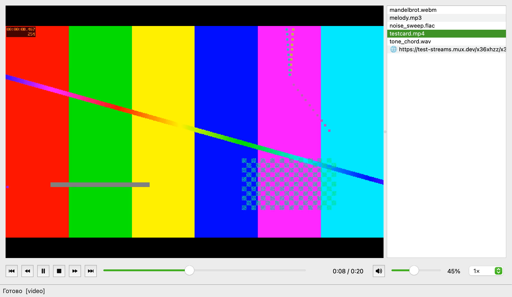
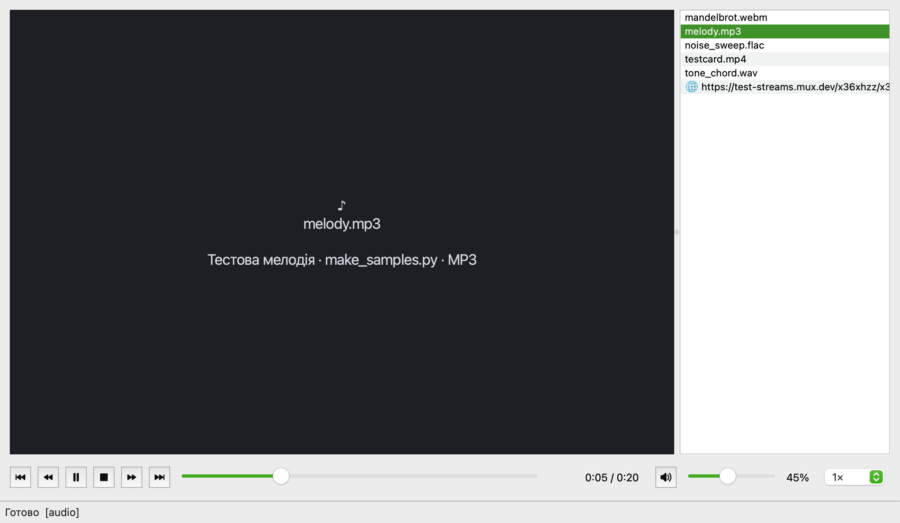
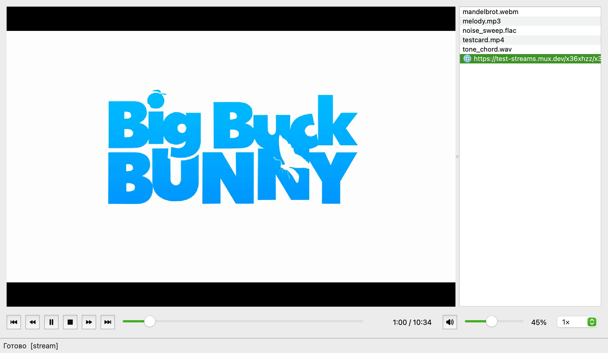

::: {custom-style="Титул"}
КИЇВСЬКИЙ НАЦІОНАЛЬНИЙ УНІВЕРСИТЕТ ІМЕНІ ТАРАСА ШЕВЧЕНКА

Факультет комп'ютерних наук та кібернетики

&nbsp;

&nbsp;

&nbsp;

**ЗВІТ**

**з лабораторної роботи №2**

з дисципліни «Розробка мультимедійних систем»

на тему: «Розробка мультимедійного застосунку з використанням сучасних технологій»

Варіант 1. Медіаплеєр

&nbsp;

&nbsp;

&nbsp;
:::

::: {custom-style="Титул праворуч"}
Виконала:

студентка групи ІПС-41

Микитченко Катерина Дмитрівна
:::

::: {custom-style="Титул"}
&nbsp;

&nbsp;

&nbsp;

Київ — 2026
:::

```{=openxml}
<w:p><w:r><w:br w:type="page"/></w:r></w:p>
```

# Мета роботи

Розробити desktop-застосунок для відтворення локальних аудіо- та відеофайлів і медіаконтенту за URL. Застосунок має підтримувати основні операції керування відтворенням: запуск, паузу, зупинку, перемотування, переміщення по запису і регулювання гучності.

# Використані засоби

- **Python 3.12** — мова реалізації.
- **PySide6 6.12 (Qt 6)** — графічний інтерфейс (Qt Widgets) і відтворення (модуль Qt Multimedia). Клас `QMediaPlayer` декодує медіа через бекенд FFmpeg, який Qt 6 використовує за замовчуванням. Тому програма відкриває всі формати й кодеки, що підтримує FFmpeg, а також HTTP(S)-адреси та HLS-потоки `.m3u8`.
- **FFmpeg** — лише для генерації тестових медіафайлів (`make_samples.py`), сам плеєр його напряму не викликає.

# Структура програми

| Файл | Вміст |
|----------|----------------------|
| `main.py` | точка входу; файли або URL можна передати аргументами командного рядка |
| `player/window.py` | клас `PlayerWindow`: головне вікно, панель керування, меню, обробка сигналів плеєра |
| `player/playlist.py` | клас `Playlist` (на базі `QListWidget`): список джерел, перехід до наступного/попереднього |
| `player/formats.py` | списки підтримуваних розширень, фільтр діалогу відкриття, форматування часу |
| `make_samples.py` | генерує тестові файли у `media/` |
| `selftest.py` | автоматична перевірка всіх функцій на кожному файлі та URL |

Архітектура відтворення в Qt Multimedia складається з трьох об'єктів. `QMediaPlayer` відповідає за джерело, декодування і стан. `QAudioOutput` виводить звук і керує гучністю. `QVideoWidget` показує кадри. Вікно лише з'єднує їх і реагує на сигнали плеєра: `positionChanged`, `durationChanged`, `playbackStateChanged`, `mediaStatusChanged`, `errorOccurred`, `metaDataChanged`.

Запуск:

```
pip install PySide6
python make_samples.py      # один раз, створює тестові файли
python main.py              # або: python main.py media/testcard.mp4
```

# Реалізація обов'язкових функцій

| Вимога | Як реалізовано |
|--------|-------------------------|
| Відкриття локального файлу | меню «Файл → Відкрити файл…» (Ctrl+O), `QFileDialog` з фільтрами «Медіафайли / Аудіо / Відео»; можна вибрати кілька файлів одразу, усі потрапляють у плейлист. Також працює перетягування файлів у вікно (drag & drop) |
| Play / Pause, Stop | кнопки на панелі та клавіші Пробіл / S. `toggle_play()` перемикає `play()`/`pause()`, `stop()` зупиняє і повертає позицію на початок. Іконка кнопки змінюється за сигналом `playbackStateChanged` |
| Перехід вперед / назад | кнопки ⏪ ⏩ і клавіші ← → перемотують на 10 с (`seek_by()`, позиція обмежується межами [0; тривалість]). Кнопки ⏮ ⏭ і клавіші P / N перемикають попередній / наступний файл у плейлисті; після завершення файлу автоматично вмикається наступний |
| Переміщення по progress bar | `SeekSlider` — нащадок `QSlider`, діапазон 0…тривалість у мс. Перетягування повзунка викликає `setPosition()`. Клік у будь-яке місце смуги одразу переносить туди позицію (перевизначено `mousePressEvent`). Під час перетягування повзунок не «стрибає» назад від сигналу `positionChanged` |
| Поточний і загальний час | мітка «0:42 / 3:15», оновлюється за `positionChanged` і `durationChanged`; для файлів довших за годину — формат h:mm:ss; для live-потоку з невідомою тривалістю показується «—» |
| Регулювання гучності | повзунок 0…100 %, клавіші ↑ ↓ (крок 5 %), кнопка та клавіша M — вимкнути звук. Положення повзунка перераховується в логарифмічну шкалу (`QtAudio.convertVolume`), бо слух сприймає гучність логарифмічно: так повзунок змінює гучність рівномірно на слух |
| ≥ 2 аудіо- і ≥ 2 відеоформати | перевірено WAV, MP3, FLAC (аудіо) і MP4 (H.264 + AAC), WebM (VP9 + Opus) (відео); у фільтрі діалогу також OGG, M4A, AAC, OPUS, MOV, MKV, AVI, M4V |
| Відтворення за URL | «Файл → Відкрити URL…» (Ctrl+U), діалог з перевіркою схеми (http, https, rtsp). Адреса додається в плейлист з позначкою 🌐 і зберігається для наступного разу. Перевірено прогресивне завантаження MP3/MP4 і адаптивний HLS-потік |

Для аудіофайлів, у яких немає відеодоріжки, замість чорного екрана показується картка з назвою файлу та метаданими з тегів (назва, виконавець, альбом, кодек). Перемикання між карткою і відео відбувається автоматично за сигналом `hasVideoChanged` через `QStackedWidget`.

# Додаткові можливості

- **Плейлист** праворуч: подвійний клік запускає файл, Delete видаляє вибраний, після кінця файлу вмикається наступний.
- **Швидкість відтворення** 0,5×…2× (`setPlaybackRate`).
- **Повноекранний режим** — подвійний клік по відео або клавіша F; гарячі клавіші працюють і в повноекранному режимі.
- **Рядок стану** показує стан завантаження (завантаження, буферизація, готово, формат не підтримується) і тип джерела (audio / video / stream).
- **Обробка помилок**: недоступний URL або пошкоджений файл не «вішає» програму, а показує повідомлення з текстом помилки від бекенда.
- **Збереження налаштувань** між запусками (`QSettings`): гучність, остання папка, останній URL.

# Тестування

Тестові файли згенеровано FFmpeg (`make_samples.py`), тривалість кожного 20 с:

| Файл | Тип | Кодеки |
|----------|------|-----------|
| `tone_chord.wav` | аудіо | PCM 16 біт, 44,1 кГц |
| `melody.mp3` | аудіо | MP3 160 кбіт/с, з ID3-тегами |
| `noise_sweep.flac` | аудіо | FLAC (без втрат) |
| `testcard.mp4` | відео | H.264 1280×720 30 fps + AAC |
| `mandelbrot.webm` | відео | VP9 854×480 25 fps + Opus |

Скрипт `selftest.py` для кожного джерела відкриває його, чекає завантаження і перевіряє: тривалість визначено, відтворення почалося, перемотування вперед і назад змінює позицію на потрібний крок, переміщення повзунка на середину переносить позицію, пауза і стоп змінюють стан, після стопу позиція дорівнює нулю. Результат:

| Джерело | Тривалість | Тип | Результат |
|-------------------|-------|------|--------|
| mandelbrot.webm | 0:20 | відео | усі перевірки пройдено |
| melody.mp3 | 0:20 | аудіо | усі перевірки пройдено |
| noise_sweep.flac | 0:20 | аудіо | усі перевірки пройдено |
| testcard.mp4 | 0:20 | відео | усі перевірки пройдено |
| tone_chord.wav | 0:20 | аудіо | усі перевірки пройдено |
| test-videos.co.uk/…/Big_Buck_Bunny_360_10s_1MB.mp4 | 0:10 | відео, URL | усі перевірки пройдено |
| soundhelix.com/…/SoundHelix-Song-1.mp3 | 6:12 | аудіо, URL | усі перевірки пройдено |
| test-streams.mux.dev/x36xhzz/x36xhzz.m3u8 | 10:34 | відео, HLS | усі перевірки пройдено |

Окремо перевірено реакцію на помилку: адреса, яка повертає HTTP 403, викликає повідомлення про помилку, після чого плеєр далі працює з іншими файлами.

# Знімки екрана

{width=100%}

{width=100%}

{width=100%}

# Висновки

1. Створено desktop-медіаплеєр на PySide6, який реалізує всі обов'язкові функції варіанта: відкриття файлу, Play/Pause/Stop, перемотування, progress bar, поточний і загальний час, гучність, відтворення за URL.
2. Використання Qt Multimedia з бекендом FFmpeg дало змогу не писати власних декодерів. Програма підтримує як мінімум три аудіо- (WAV, MP3, FLAC) і два відеоформати (MP4/H.264, WebM/VP9), а також HTTP-завантаження і HLS-потоки.
3. Керування побудоване на сигналах і слотах Qt. Інтерфейс не опитує плеєр у циклі, а реагує на зміну позиції, тривалості, стану й статусу медіа. Тому програма не блокується під час буферизації мережевого потоку.
4. Додатково реалізовано плейлист, зміну швидкості, повноекранний режим, гарячі клавіші, drag & drop, показ метаданих і збереження налаштувань.
5. Коректність роботи перевірено автоматичним тестом на п'яти локальних файлах і трьох мережевих джерелах; усі перевірки пройдено.
